<div align="center">

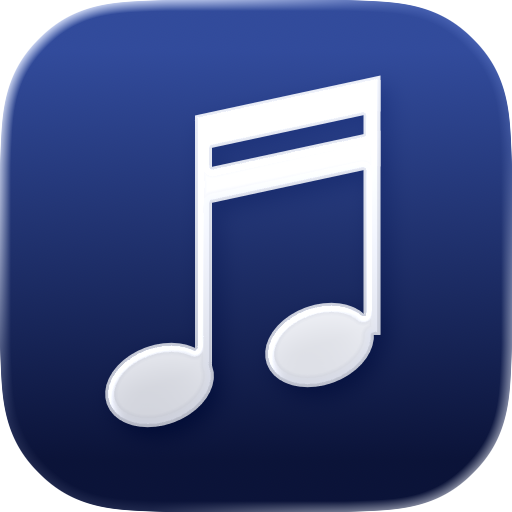

# Groovelight

**A music player for people who own their music.**

A native music player and library manager for **Mac and Windows**, with **Groovelight for Android** (and iPhone and iPad, in development) to take it with you. The look of Apple Music and the soul of iTunes: bit-perfect hi-res playback, every format you have, a 15-band parametric EQ, synced lyrics, credits, Cover Flow, visualizers, a Home that knows your listening, and your library on your DAP, SD card or phone. And a music player you can talk to: ask Claude to play, find, import and fix your music, or script it from a terminal.


[](LICENSE)


[](https://www.buymeacoffee.com/irwing)

[Download](https://github.com/irwingbraga/groovelight/releases/latest) · [Platforms](#platforms) · [Features](#features) · [Claude and the command line](#works-with-claude-and-your-scripts) · [Build from source](#build-from-source)

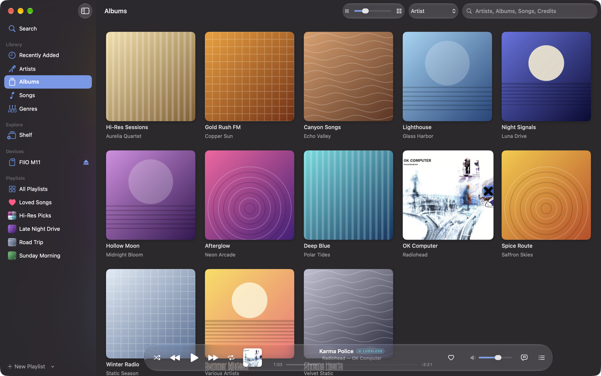

</div>

## Platforms

| | What it is | Get it |
|---|---|---|
| **Mac** | The player and library manager, in SwiftUI with Liquid Glass (macOS 15 or later). | The DMG from [Releases](https://github.com/irwingbraga/groovelight/releases/latest). |
| **Windows** | The same player in a Windows 11 (Fluent) interface: C#, .NET 10 and WinUI 3, for x64 and ARM64. | The installer, or the portable exe that runs without installing, from [Releases](https://github.com/irwingbraga/groovelight/releases/latest). |
| **Android** | A full player for phones, tablets, foldables and DAPs, with your library as the Mac or the PC knows it, synced over Wi-Fi (Android 12 or later). | The APK from [Releases](https://github.com/irwingbraga/groovelight/releases/latest), see [`android/README.md`](android/README.md). |
| **iPhone and iPad** | The same companion for iOS and iPadOS 26. | In development: [build from source](#build-from-source). |

Your library lives on your computer, Mac or PC. The phones pair with it, sync the music you choose, browse everything else, play on the computer, and send back what you played and loved.

## Why Groovelight

Streaming apps treat local files as an afterthought, and audiophile players often look like it is still 2005. Groovelight is built around the library you already own, and makes it a pleasure to use.

- **Hear the file, not a resampled copy.** Bit-perfect mode switches your DAC to each song's sample rate and bit depth, can take the device exclusively, and turns everything that would alter the sound off. The quality badge tells you whether what reaches the DAC is untouched.
- **Every format, including the ones Music will not play.** FLAC (up to 24-bit / 192 kHz and beyond), ALAC, WAV, AIFF, MP3, AAC, Ogg Vorbis, Opus, WavPack, Monkey's Audio, Musepack, TTA, Speex and tracker modules, plus whole albums stored as one file with a CUE sheet. Gapless, always.
- **A real equalizer.** 15 parametric bands (type, frequency, gain and Q), a draggable response curve, automatic preamp against clipping, presets, and AutoEq / Equalizer APO import for headphone correction.
- **Your library, understood.** Musicians, producers and songwriters from MusicBrainz, with pages for each person; album and artist stories from Wikipedia; synced lyrics; missing tags fixed from MusicBrainz after you review every change; files renamed into a clean folder layout, with undo.
- **Loudness that matches.** Sound Check style normalization from ReplayGain tags, and songs without them measured in the background (EBU R128).
- **Take it with you.** Sync chosen playlists, artists, albums or genres to a DAP or SD card with covers, lyrics and playlists in the layout players expect, or wirelessly to Groovelight for Android, a full player for Android phones and DAPs with your library as the Mac knows it. Only what changed is copied. Drag an album or songs onto a device in the sidebar to add them and sync.
- **Nostalgia, done properly.** Now Playing can become a real-looking player: a turntable with a chrome tonearm and a receiver's dial, a cassette deck with gold-foil tapes, backlit VU meters and the tape's cueing sound, a top-loading CD player, or a PC Player straight from the late 1990s (the classic two-window skin, or Corona, the glassy blue player of 2002) on a hill-and-sky desktop. Plus Cover Flow with the flip to the track list, and full-screen Metal visualizers in the spirit of iTunes and Windows Media Player.
- **A Home that knows your listening.** Song, Album and Artist of the Day picked from what you play (songs you used to love, loved songs you hardly play, new additions, anniversaries), each with its reason, and Your Listening: time by day, when and where you listen, top songs, albums and artists, genres and decades. Import your Last.fm history and it knows years of listening from day one. Worked out on your computer, never in someone's cloud.
- **Talk to your library.** Groovelight works with Claude: "play Living Inside Myself by Gino Vannelli", "make a playlist of his ten best songs", "import the album in my Downloads and fix its tags". It also has a command line tool for your own scripts. Changes to files always come as a preview you approve first. See [below](#works-with-claude-and-your-scripts).
- **Local and open.** No account, no subscription, no cloud. Your music, your files, your history. Open source under the GPL.

## Works with Claude and your scripts

Groovelight comes with `groovelight`, a command line tool that drives the running app (on the Mac and on Windows), and with an MCP server built on it, so AI assistants can use your library the way you do. Your music stays on your computer: Claude only sees the results of what it asks Groovelight to do.

**With Claude Desktop**, download `Groovelight-<version>.mcpb` from the [latest release](https://github.com/irwingbraga/groovelight/releases/latest) and open it. Then just ask:

> *Play Kid A on shuffle.*<br>
> *Which albums do I have by Radiohead?*<br>
> *Make a playlist with the ten best Gino Vannelli songs I have.*<br>
> *Import the zip in my Downloads, and move it to the Trash afterwards.*<br>
> *The tags on "OK Computer" are a mess: fix them from MusicBrainz.*<br>
> *What's my album of the day? Play it.* / *What did I listen to most this year?*

- **18 tools:** search the library, play albums, artists, playlists and songs, control playback, see what is playing, create and fill playlists, import songs, folders and archives, fix metadata from MusicBrainz, organize file names, rescan, undo, today's picks and your listening stats.
- **Nothing changes behind your back.** Imports, metadata fixes and renames are previewed first. Claude shows you what would change and applies exactly that preview, only after you agree. Imports and organizing can be undone.
- **Built to be safe with an AI.** No tool reads file contents. Private and system folders (`~/Library` or `AppData`, hidden folders, the home folder as a whole) are refused. Links inside archives are dropped. The server talks only to the app on your computer.
- **Claude Code** too: `claude mcp add groovelight -- /usr/local/bin/groovelight mcp` on a Mac (on Windows, Settings, General, Command Line shows the command with the tool's path). Any other MCP client can run `groovelight mcp`.

**From a terminal**, every command takes `--json`, and the ones that change files take `--dry-run`:

```sh
groovelight import ~/Downloads/album.zip --trash-archives --dry-run
groovelight fix-metadata --album "OK Computer" --dry-run
groovelight play --album "Kid A" --shuffle
groovelight now-playing --json | jq -r '"\(.title) - \(.artist)"'
groovelight today
groovelight stats --range year
```

Settings, General, Command Line puts the tool in your PATH: on the Mac it shows the one-line command, on Windows it is a button. It also shows the exact command for Claude Code. The full references are [docs/CLI.md](docs/CLI.md) (every command, JSON output, scripting) and [docs/MCP.md](docs/MCP.md) (connecting Claude, the tools, the safety model).

## A tour

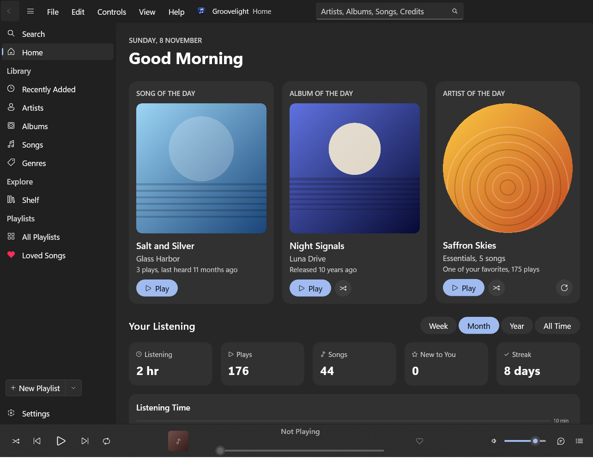

**Home**, here on Windows: Song, Album and Artist of the Day with why they were picked, and your listening for the last week, month, year or all time.

| | |
|---|---|
| 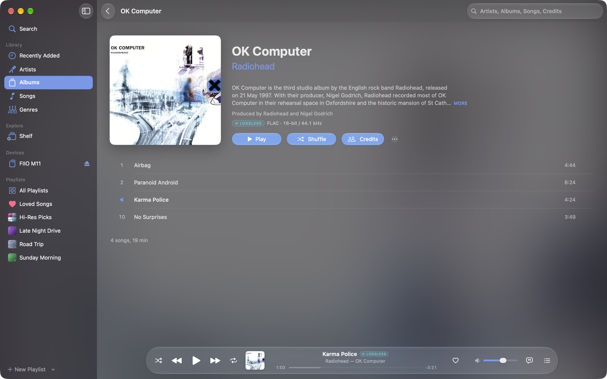 | 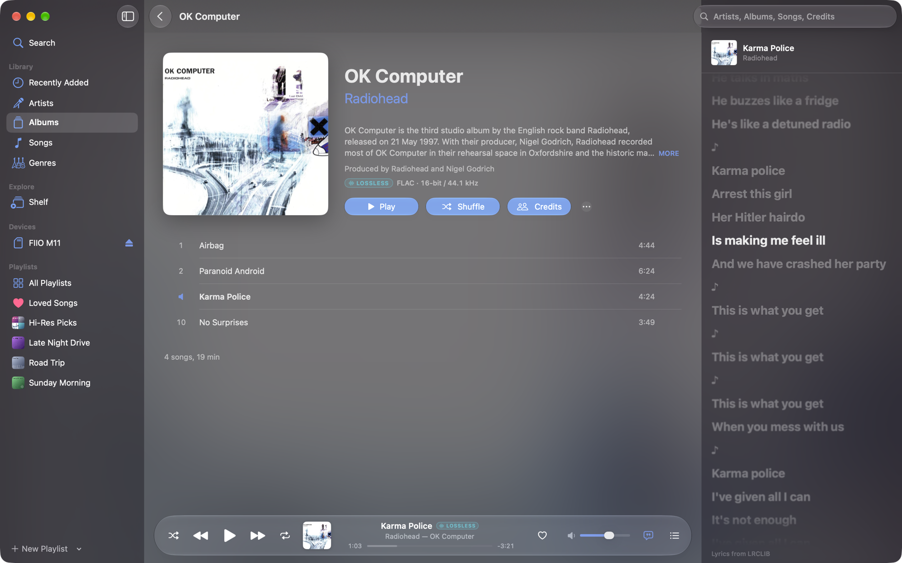 |
| **Album pages** with the story behind the record, the producer, a quality badge and credits. | **Synced lyrics** follow the song, in the side panel or full screen; click a line to jump there. |
| 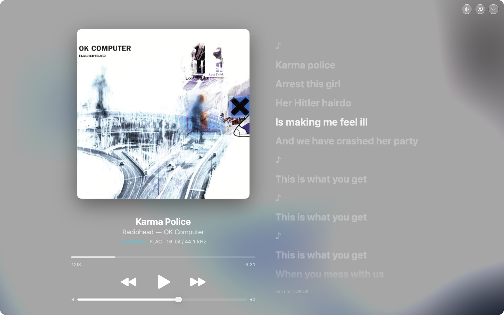 | 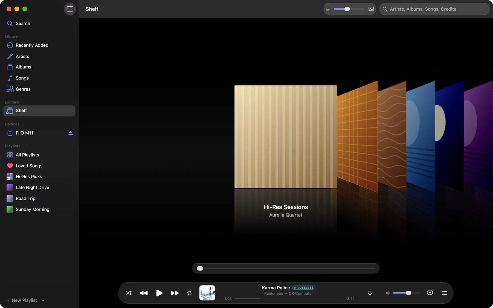 |
| **Now Playing** grows with the window, with lyrics beside the cover and an animated backdrop. | **The Shelf**: Cover Flow on a glossy floor; click the center cover to flip it to its songs. |
| 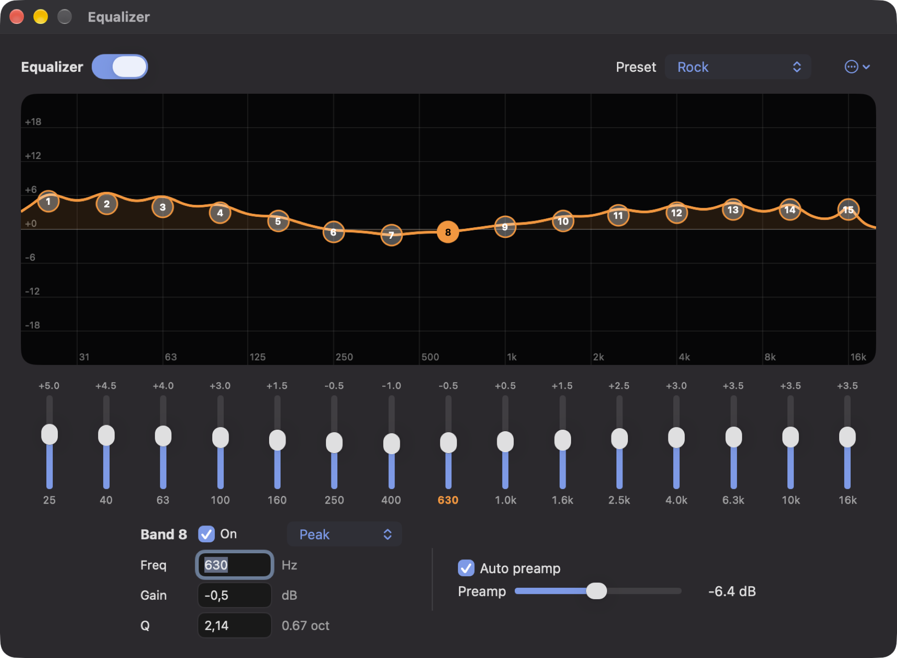 | 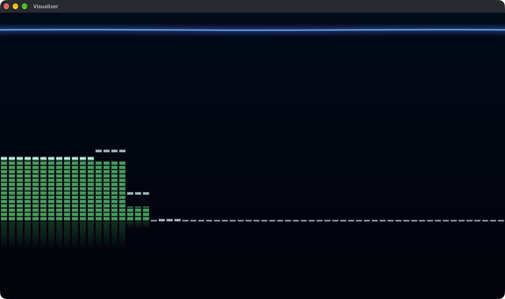 |
| **15-band parametric EQ** with a draggable curve, presets and automatic preamp. | **Visualizers** rendered with Metal: Bars & Waves, Lights, Ambience and Magnetosphere. |
| 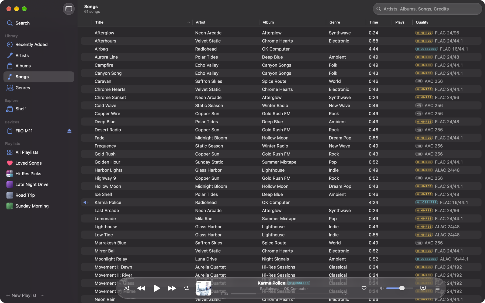 | 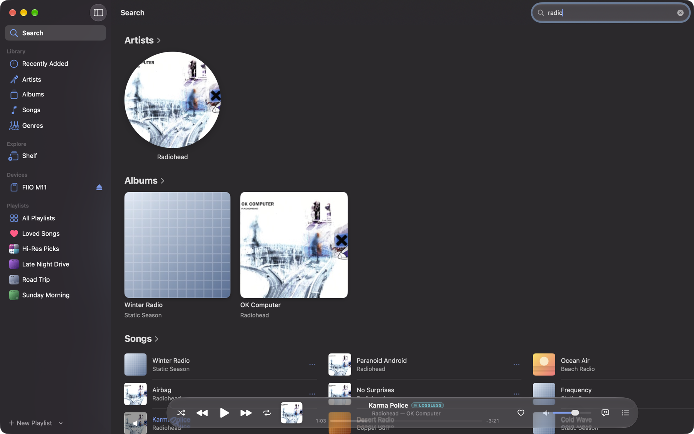 |
| **Songs** with format and resolution for every file: Hi-Res, Lossless or High Quality at a glance. | **Search** across artists, albums, songs and the people in the credits. |
| 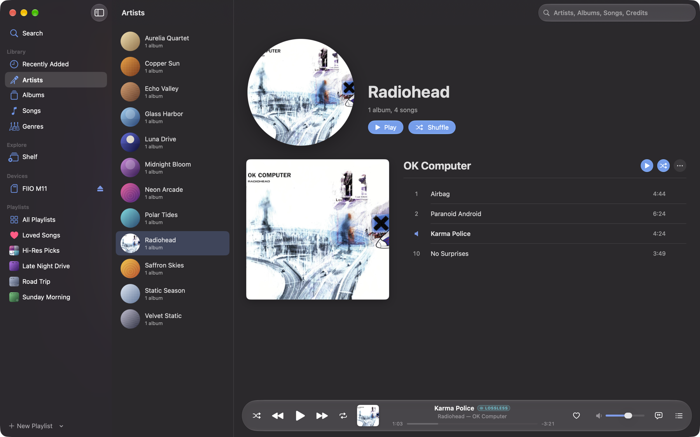 | 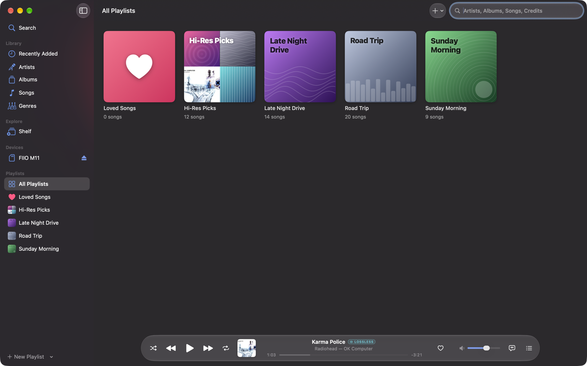 |
| **Artist pages** with every album and its songs, Music style. | **Playlists** with covers you design, and smart playlists that update themselves. |

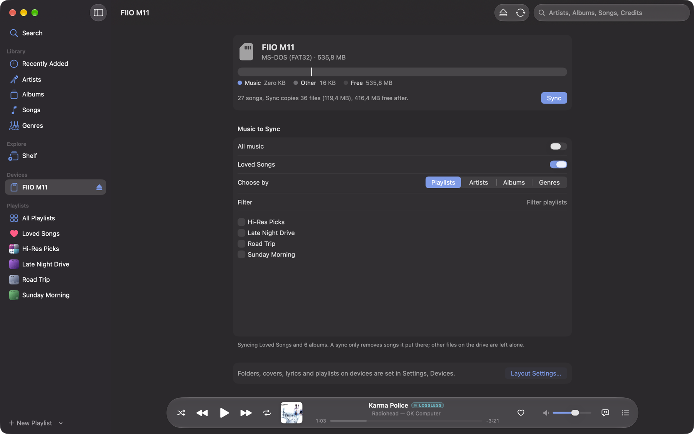

**Devices**: plug in a DAP or an SD card, choose what goes on it, see how much room it takes, and sync.

## Features

Everything below is on the Mac and on Windows unless it says otherwise; the phones have their own section under [Devices](#devices).

### Home
- Song, Album and Artist of the Day from your listening: songs much played and not heard in a while, loved or highly rated songs you hardly play, recent additions, albums released a round number of years ago, and your favorite artists. Each shows why it was picked; it stays all day and does not come back for a while (90 days for a song, 30 for an album, 14 for an artist). Something Else shows a few more; an artist plays their essentials.
- Your Listening for the last week, month, year or all time: listening time, plays, songs, songs new to you and your streak; listening time by day, split by where you listened (this computer, phones, Last.fm); when you listen, by weekday and hour; top songs, albums and artists; genres and decades.
- A listening log of every play and skip, with its time, including the phones'. Import your whole Last.fm history in the background (Settings, Last.fm, History), matched to your songs even when names differ a little, and kept up to date every 6 hours.
- The Mac and the PC make the same picks from the same library; the phones show Home from them and keep it for when they are away.

### Library
- Watches your music folders live, catches up with what changed while it was closed, and keeps songs on unplugged drives until they come back.
- Several library folders, on internal, external or network drives (on the Mac with security-scoped access, in a sandboxed app).
- Recently Added, Artists, Albums (cover size by slider, menu or pinch), Songs (sortable table with quality), Genres.
- Album artists and compilations, multi-disc albums, CUE sheets (external or embedded) shown as individual songs.
- Search with categories (artists, albums, songs, credited people), recent searches, and a toolbar field reachable everywhere (⌘F, Ctrl+F).
- Get Info with a tag editor for one song or many at once; ratings, loves with dates, play and skip counts.
- Import songs, folders or archives (zip, 7z, rar, tar) by dragging them onto the window or with ⌘O (Ctrl+O): identified on MusicBrainz and moved or copied into your layout, in the library folder chosen in Settings. Archives are extracted first and can go to the Trash afterwards (Undo Import puts them back).
- Organize files into a folder and name template you choose, previewed before anything moves, with undo.
- Backups of the whole library (history, playlists, metadata fixes, settings) and restore, including relinking moved folders.

### Playback
- Gapless playback, crossfade (1 to 12 s, keeping albums gapless if you like), playback speed with pitch kept, sleep timer (minutes or end of song).
- Bit-perfect output: the device follows each song's sample rate and the deepest integer format, exclusive access on request (Core Audio hog mode on the Mac, WASAPI exclusive mode on Windows), device volume used instead of digital volume.
- Sound Check: ReplayGain (track or album) and EBU R128 measurement for songs without tags.
- Up Next queue with Play Next and Add to Up Next everywhere, shuffle, repeat one or all.
- Media keys, Control Center on the Mac and the media overlay on Windows, a mini player (in the menu bar on the Mac), taskbar controls on Windows, and a floating player bar (Liquid Glass on macOS 26).

### Sound
- 15-band parametric equalizer: peak, shelf, pass and notch filters per band, frequency 20 Hz to 20 kHz, gain ±24 dB, Q 0.1 to 18.
- Draggable curve over a log-frequency scale, sliders, an on/off switch to compare, automatic preamp.
- Built-in presets, your own presets, import and export of AutoEq / Equalizer APO `ParametricEQ.txt`.
- Audio quality details for every song: codec, bit depth, sample rate, bitrate, and what actually reaches the output device.

### Now Playing, lyrics and visualizers
- Full-screen Now Playing that scales to large displays, with an animated artwork backdrop, and shuffle and repeat beside its transport.
- Vintage looks that turn all of Now Playing into a real-looking player, made of photographed walnut, brushed aluminum, felt and black plastic:
  - **Turntable:** the record turns with the cover as its label, and the tonearm moves in as the song plays (drag it to go to another part). Aluminum keys, the song in a receiver's amber dial window (drag its red pointer to seek), toggle switches and a volume knob.
  - **Cassette deck:** the cassette behind a smoked door with its reels winding (molded plastic, paper labels, gold and silver foil print), backlit VU meters following the music's left and right levels, a rolling tape counter and piano keys (hold rewind or fast forward to scan, with the tape's cueing sound unless turned off in Settings).
  - **CD player:** a top-loading well with the disc printed with the cover, and a fluorescent display with the time, the song stepping through and a position bar to drag.
  - **PC Player:** a desktop music player of the late 1990s after the classic two-window skin, on a wallpaper of a green hill under a blue sky: the green display with the time (tap for the time left) and a spectrum, the title scrolling by, the bit rate and sample rate, volume, EQ and PL keys, the position bar, the transport keys and a heart to love the song, docked over the playlist (the queue, the song playing in white; tap a song to play it). A second theme, Corona, is the glassy blue media player of 2002: the screen with its spectrum or the cover, the green metadata strip, the transport drawer (a large round play, stop, previous, next, mute, a volume wedge, the seek bar) and the playlist drawer beside or under it.
  - Each lays itself out for the screen: phones, a foldable folded or open, the two halves of a half-open fold, an iPad and a Mac window.
  - Chosen with the look button at the top of Now Playing (also the PC Player's theme and your cassettes), on the Mac, iPhone, iPad and Android.
- Your own cassettes: their colors, label and text, or your own pictures of the shell and the label drawn on the template. Share one as a `.cassette` file that opens on the Mac, iPhone, iPad and Android.
- Synced (LRC) lyrics from your files or LRCLIB, karaoke-style line following, click to seek; plain lyrics too.
- Lyrics and Up Next side panels on every page.
- Cover Flow shelf with reflections, keyboard, trackpad and scrubber control, and the flip to the track list.
- Visualizers: Bars & Waves, Lights, Ambience and Magnetosphere, in a window or full screen (Metal on the Mac, SkiaSharp on Windows).

### Metadata
- Fix Metadata: candidates from MusicBrainz, a field-by-field review, optional writing to the files.
- Artwork from your files, cover images in the folder, the Cover Art Archive and the iTunes Search API.
- Credits (performers, producers, engineers, songwriters, studios) with a page for every person and the songs they worked on.
- Album and artist backgrounds from Wikipedia, artist photos.
- Fetch Missing Info for the whole library in the background.

### Playlists
- Playlists with drag and drop and reordering; smart playlists with rules, limits and live updates; Loved Songs.
- Covers: generated colors and patterns with the playlist's name, your own image, or a mosaic of the songs' covers, also in the sidebar.
- Import M3U, M3U8, PLS, XSPF, WPL and Music / iTunes XML; export M3U8, M3U, PLS, XSPF and Music XML, with absolute or relative paths.

### Devices
- DAPs in USB disk mode, SD cards and USB drives appear under Devices while they are connected, on the Mac and on Windows.
- Choose all music or a mix of playlists, artists, albums, genres and Loved Songs; see what a sync copies and removes, and the space left.
- One layout for every device: folders and names, cover.jpg size, .lrc lyrics, M3U8 playlists. Names safe for FAT32 and exFAT; files over 4 GB left out of FAT32 cards.
- Incremental: only new and changed files are copied; only Groovelight's own files are ever removed.
- Send to: any song, album or playlist to a device or a folder, from its menu.
- **Groovelight for Android** (Android 12+): pairs with the Mac or the PC with a code shown on both screens, then syncs over Wi-Fi (encrypted) to internal storage or the SD card, by itself every 15 minutes if you like. Downloads resume. Away from home, it reaches the computer through Tailscale, for the devices you allow. (Below, "the Mac" means the Mac or the PC.)
  - **A player** with the library as the Mac knows it: albums, artists, songs, playlists and smart playlists, credits, synced lyrics, loves and ratings, Sound Check, gapless playback and crossfade, the 15-band EQ with the Mac's presets, bit-perfect USB output, the Shelf and visualizers. Or **Sync only**, for another player app.
  - **Your whole Mac library** on the phone: add albums, artists or songs to it from there (asked for while the Mac is away, they go when it is back), in their original format or as Opus, AAC or MP3, album by album.
  - **Back to the Mac:** plays (scrobbled to Last.fm with their times), skips, loves, ratings and playlist edits made on the phone.
  - **Play On:** play on the Mac, or on another phone with Groovelight open, from the phone: start, pause, skip, seek and set the volume there, hand the music over between them, and play anything of the Mac's library on the Mac, on the phone or not.
  - **Home:** the picks of the day and Your Listening, from the computer, as the first tab, with Play here or on the computer, and Bring Here for picks not on the phone.
  - **Foldables and tablets:** unfolded or on a tablet, a sidebar as on the iPad, Now Playing with the lyrics or Up Next beside the cover, and a player bar docked along the bottom; folded, Now Playing fits the short cover screen.
  - Home screen widgets, a Quick Settings tile, Android Auto and voice search ("play ... on Groovelight").
- **Groovelight for iPhone and iPad** (in development): the same companion for iOS and iPadOS 26, with the Mac's layout on the iPad (sidebar, player bar), Home, the vintage looks, the Shelf, the EQ and the visualizers.

### Last.fm
- Scrobbling with Last.fm's rules, Now Playing updates, love and unlove synced with the heart button.
- Scrobbles made offline are kept and sent later.
- Your Last.fm history imported into Home (see [Home](#home)).

### Mac
- Liquid Glass throughout on macOS 26, and the classic translucent look on macOS 15; light and dark (the Shelf is always dark), one library window like Music.
- Every action in the menus; keyboard shortcuts you can remap (Settings, Shortcuts).
- Updates from GitHub releases, verified before installing (Sparkle).

### Windows
- A Windows 11 (Fluent 2) interface with Mica, a navigation pane with the Mac's places and your playlists' covers, the menu bar of the Mac app, light and dark.
- Keyboard shortcuts with Ctrl for ⌘ and Alt for ⌥, remappable in Settings, Shortcuts.
- An installer per architecture (x64, ARM64) that keeps Groovelight up to date from GitHub releases (Velopack), or a portable single-file exe to run without installing.

### Command line and Claude
- `groovelight` controls the running app from a terminal, scripts and AI tools, on the Mac and on Windows: `status`, `search`, `import` (songs, folders, archives), `fix-metadata`, `organize`, `undo`, `rescan`, `play`, `pause`, `next`, `now-playing`, `today`, `stats` and more. Every command takes `--json`, and the ones that change files take `--dry-run`.
- The tool asks the app to do the work, so the library, undo and the windows stay in step; it starts Groovelight in the background when needed.
- Settings, General, Command Line puts it in your PATH (a one-line command on the Mac, a button on Windows).
- **Use it with Claude:** `groovelight mcp` is an MCP server. Claude Desktop installs it from the extension attached to each release (`Groovelight-<version>.mcpb`: download and open it); Claude Code with `claude mcp add groovelight -- /usr/local/bin/groovelight mcp`. Claude can then search your library, play music, and import, fix and organize files. Changes to files always come as a preview first, applied only after you agree.

- See [Works with Claude and your scripts](#works-with-claude-and-your-scripts), [docs/CLI.md](docs/CLI.md) and [docs/MCP.md](docs/MCP.md).

## Install

Everything is on the [latest release](https://github.com/irwingbraga/groovelight/releases/latest):

- **Mac:** download the DMG, open it and drag Groovelight to Applications. Requires macOS 15 (Sequoia) or later; on macOS 26 it uses Liquid Glass. It updates itself.
- **Windows:** run `Groovelight-win-Setup.exe` (x64) or `Groovelight-win-arm64-Setup.exe` (ARM64). It installs for your account (no administrator needed), includes the `groovelight` command and updates itself. Or run `Groovelight-<version>-win-x64-Portable.exe` from anywhere: one file with everything in it, no installation, no updates and no `groovelight` command. Requires Windows 11 (22H2 or later).

> [!NOTE]
> Groovelight is a **preview**: the 0.x releases are not a final 1.0. Everything described here works, but expect rough edges and changes between versions, and keep a backup of your music before using Fix Metadata or Organize. Bug reports are very welcome in [Issues](https://github.com/irwingbraga/groovelight/issues).

- **Android:** Groovelight for Android is attached to each release as an APK (`Groovelight-<version>.apk`, Android 12 or later; it updates Groovelight Sync in place and then updates itself): see [`android/README.md`](android/README.md) for installing it.

## Keyboard shortcuts

The defaults are below, for the Mac; on Windows they are the same with Ctrl for ⌘, Alt for ⌥ and Shift for ⇧. Every shortcut is also in the menus, and each one can be changed, removed or reset in Settings, Shortcuts (keys already used by another command or by macOS are refused). On non-US keyboards macOS may move some default keys (Back shows as ⌘Ç on a Portuguese layout); recorded shortcuts keep the exact keys pressed.

| Action | Shortcut |
|---|---|
| Play / Pause | Space (outside text fields), ⌥⌘P |
| Next / Previous | ⌘ Right Arrow / ⌘ Left Arrow |
| Skip forward / back 10 seconds | ⌥⌘ Right Arrow / ⌥⌘ Left Arrow |
| Volume up / down, Mute | ⌘↑ / ⌘↓, ⌥⌘↓ |
| Shuffle, cycle Repeat (off, all, one) | ⌘S, ⌘R |
| Love the current song, Go to Current Song | ⇧⌘L, ⌘L |
| Search Library, Home | ⌘F, ⇧⌘H |
| Recently Added, Artists, Albums, Songs, Genres, Shelf, All Playlists, Loved Songs | ⌘1 to ⌘8 |
| Back | ⌘[ |
| Now Playing (Esc closes it), Lyrics, Up Next | ⇧⌘F, ⌥⌘L, ⌥⌘U |
| Visualizer, Equalizer | ⌘T, ⌥⌘E |
| Bigger / Smaller covers (Albums page; also its toolbar slider and pinching) | ⌘+ / ⌘− |
| Library window (a single window; reopens it after closing) | ⌘0 |
| New Playlist, New Smart Playlist | ⌘N, ⌥⌘N |
| Import (songs, folders or archives), Add Folder to Library | ⌘O, ⇧⌘O |
| Fetch Missing Info in Background, Back Up Library | ⇧⌘U, ⌥⌘B |
| Settings | ⌘, |

## Build from source

The Mac app and the iPhone and iPad app:

```sh
brew install xcodegen
git clone https://github.com/irwingbraga/groovelight.git && cd groovelight
xcodegen generate
open Groovelight.xcodeproj        # or: xcodebuild -scheme Groovelight -configuration Release build
(cd GroovelightKit && swift test) # the package's tests
```

Requirements: Xcode 26+ (the app runs on macOS 15+). The code layout, the release pipeline, the demo library, performance tests and the debug tours are described in [docs/DEVELOPMENT.md](docs/DEVELOPMENT.md).

Windows needs the .NET 10 SDK; the app builds on Windows, its core and tests anywhere (see [`windows/README.md`](windows/README.md)):

```sh
cd windows
./scripts/get-ffmpeg.ps1                    # FFmpeg (LGPL), once
dotnet test --project tests/Groovelight.Tests
dotnet build src/Groovelight.App -p:Platform=x64 -r win-x64
```

Android builds with Gradle and JDK 17 (see [`android/README.md`](android/README.md)): `cd android && ./gradlew assembleGithubDebug`.

## Built with

On the Mac, [SFBAudioEngine](https://github.com/sbooth/SFBAudioEngine) for decoding and playback, [GRDB](https://github.com/groue/GRDB.swift) for the library and [Sparkle](https://sparkle-project.org) for updates. On Windows, [WinUI 3](https://github.com/microsoft/microsoft-ui-xaml) and the Windows App SDK, [FFmpeg](https://ffmpeg.org) for decoding, [NAudio](https://github.com/naudio/NAudio) for WASAPI, [SkiaSharp](https://github.com/mono/SkiaSharp) for drawing, [TagLib#](https://github.com/mono/taglib-sharp) for tags and [Velopack](https://velopack.io) for updates. On Android, Jetpack Compose, Media3 and Room. All of them, and the codec libraries, are listed in [THIRD_PARTY_NOTICES.md](THIRD_PARTY_NOTICES.md). Metadata from [MusicBrainz](https://musicbrainz.org), the [Cover Art Archive](https://coverartarchive.org), [Wikipedia](https://www.wikipedia.org), [LRCLIB](https://lrclib.net) and [Last.fm](https://www.last.fm).

The albums in the screenshots are a demo library generated by Groovelight's tests (made-up artists, synthesized music, generated covers), plus one real album to show credits and lyrics.

## Support

Groovelight is free and always will be. If it makes your music sound better, you can [buy me a coffee](https://www.buymeacoffee.com/irwing).

<a href="https://www.buymeacoffee.com/irwing"></a>

## License

Groovelight is free software under the [GNU General Public License v3.0](LICENSE). The software it includes keeps its own licenses: see [THIRD_PARTY_NOTICES.md](THIRD_PARTY_NOTICES.md).
