<div align="center">

# Groovelight

**A music player for people who own their music.**

A native macOS player and library manager with the look of Apple Music and the soul of iTunes: bit-perfect hi-res playback, every format you have, a 15-band parametric EQ, synced lyrics, credits, Cover Flow, visualizers, and your library on your DAP, SD card or Android phone.

[](LICENSE)


[Download](https://github.com/irwingbraga/groovelight/releases/latest) · [Features](#features) · [Build from source](#build-from-source)

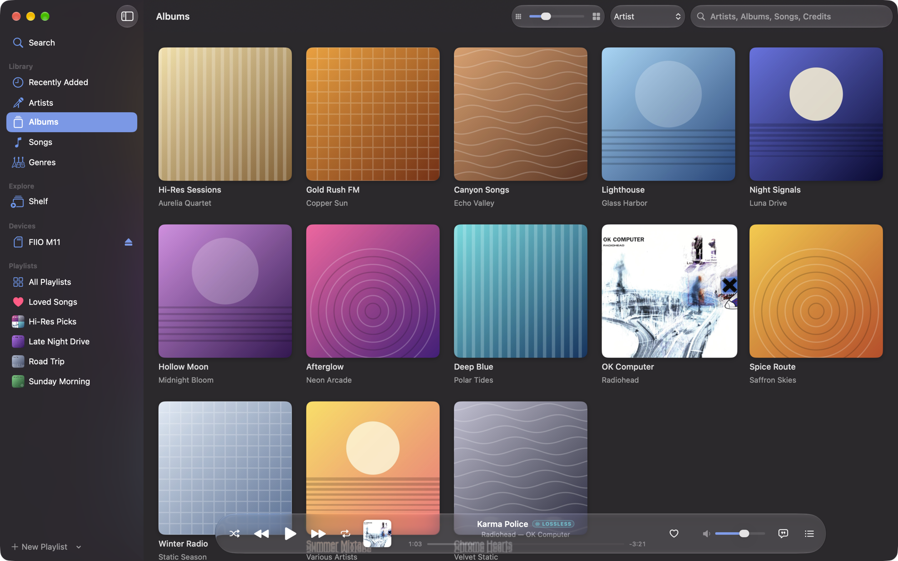

</div>

## Why Groovelight

Streaming apps treat local files as an afterthought, and audiophile players often look like it is still 2005. Groovelight is built around the library you already own, and makes it a pleasure to use.

- **Hear the file, not a resampled copy.** Bit-perfect mode switches your DAC to each song's sample rate and bit depth, can take the device exclusively, and turns everything that would alter the sound off. The quality badge tells you whether what reaches the DAC is untouched.
- **Every format, including the ones Music will not play.** FLAC (up to 24-bit / 192 kHz and beyond), ALAC, WAV, AIFF, MP3, AAC, Ogg Vorbis, Opus, WavPack, Monkey's Audio, Musepack, TTA, Speex and tracker modules, plus whole albums stored as one file with a CUE sheet. Gapless, always.
- **A real equalizer.** 15 parametric bands (type, frequency, gain and Q), a draggable response curve, automatic preamp against clipping, presets, and AutoEq / Equalizer APO import for headphone correction.
- **Your library, understood.** Musicians, producers and songwriters from MusicBrainz, with pages for each person; album and artist stories from Wikipedia; synced lyrics; missing tags fixed from MusicBrainz after you review every change; files renamed into a clean folder layout, with undo.
- **Loudness that matches.** Sound Check style normalization from ReplayGain tags, and songs without them measured in the background (EBU R128).
- **Take it with you.** Sync chosen playlists, artists, albums or genres to a DAP or SD card with covers, lyrics and playlists in the layout players expect, or wirelessly to an Android player or phone with the companion app. Only what changed is copied.
- **Nostalgia, done properly.** Cover Flow with the flip to the track list, and full-screen Metal visualizers in the spirit of iTunes and Windows Media Player.
- **Local and open.** No account, no subscription, no cloud. Your music, your files, your history. Open source under the GPL.

## A tour

| | |
|---|---|
| 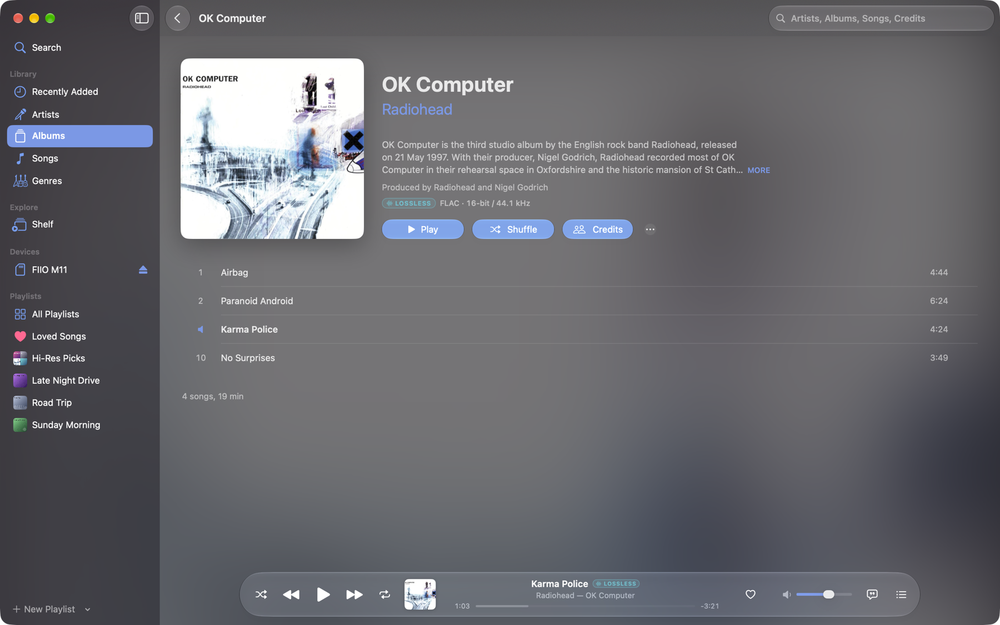 | 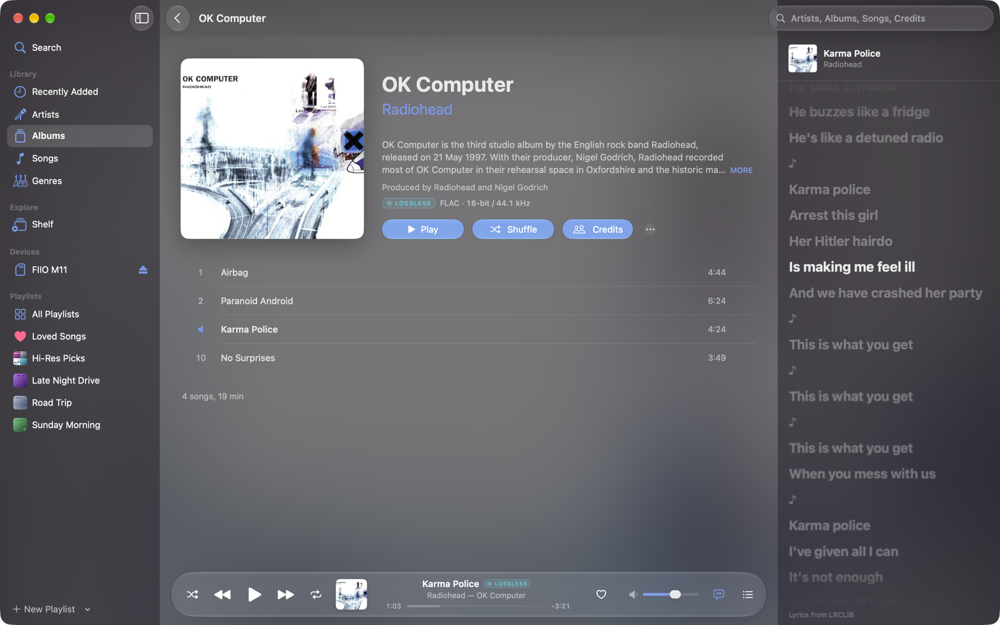 |
| **Album pages** with the story behind the record, the producer, a quality badge and credits. | **Synced lyrics** follow the song, in the side panel or full screen; click a line to jump there. |
| 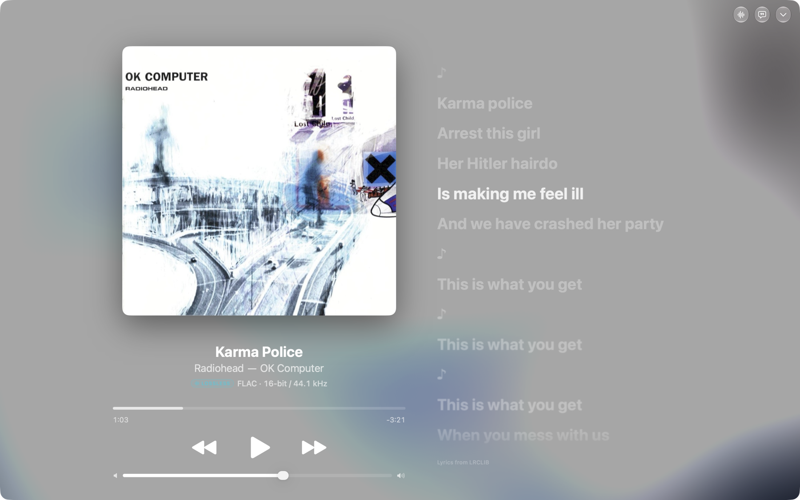 | 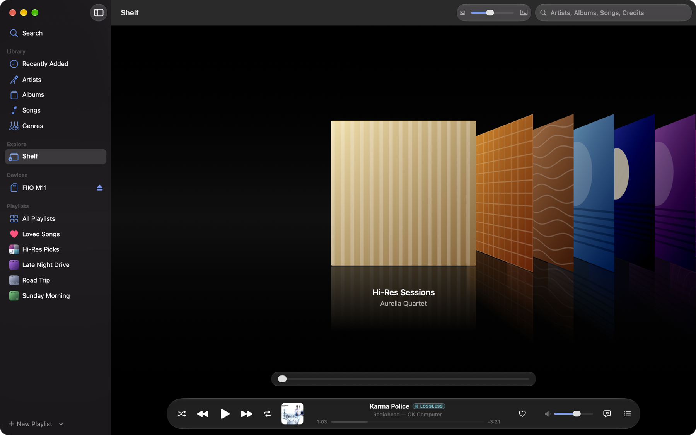 |
| **Now Playing** grows with the window, with lyrics beside the cover and an animated backdrop. | **The Shelf**: Cover Flow on a glossy floor; click the center cover to flip it to its songs. |
| 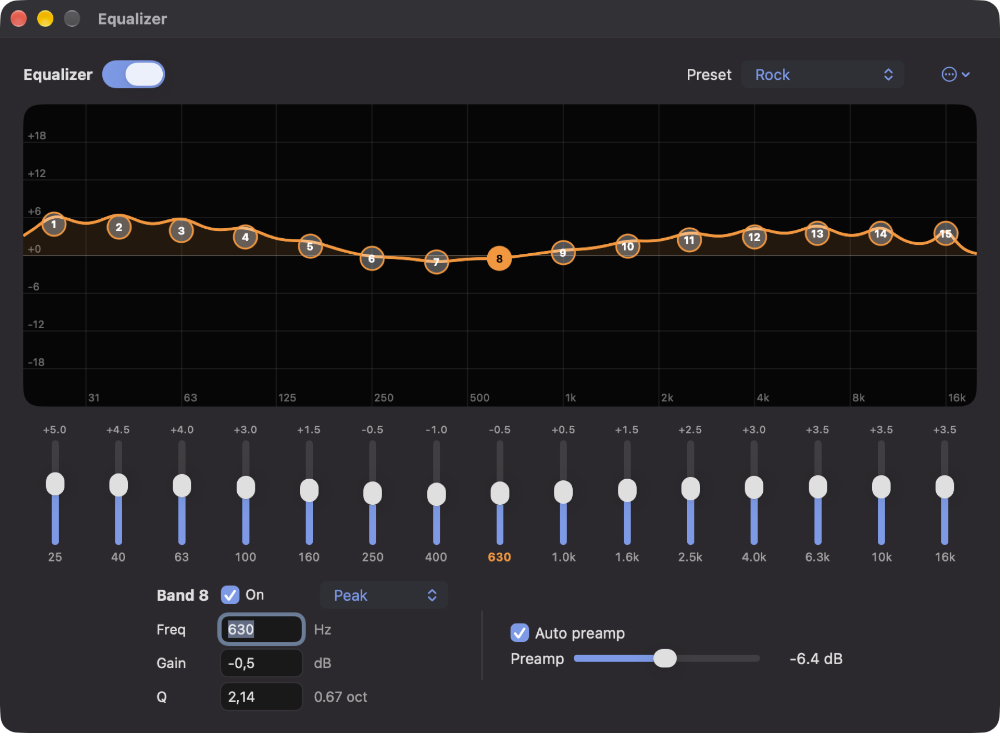 | 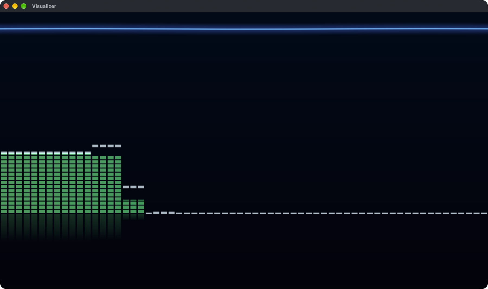 |
| **15-band parametric EQ** with a draggable curve, presets and automatic preamp. | **Visualizers** rendered with Metal: Bars & Waves, Lights, Ambience and Magnetosphere. |
| 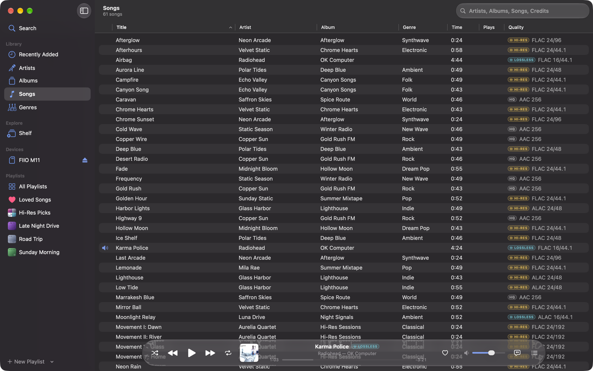 | 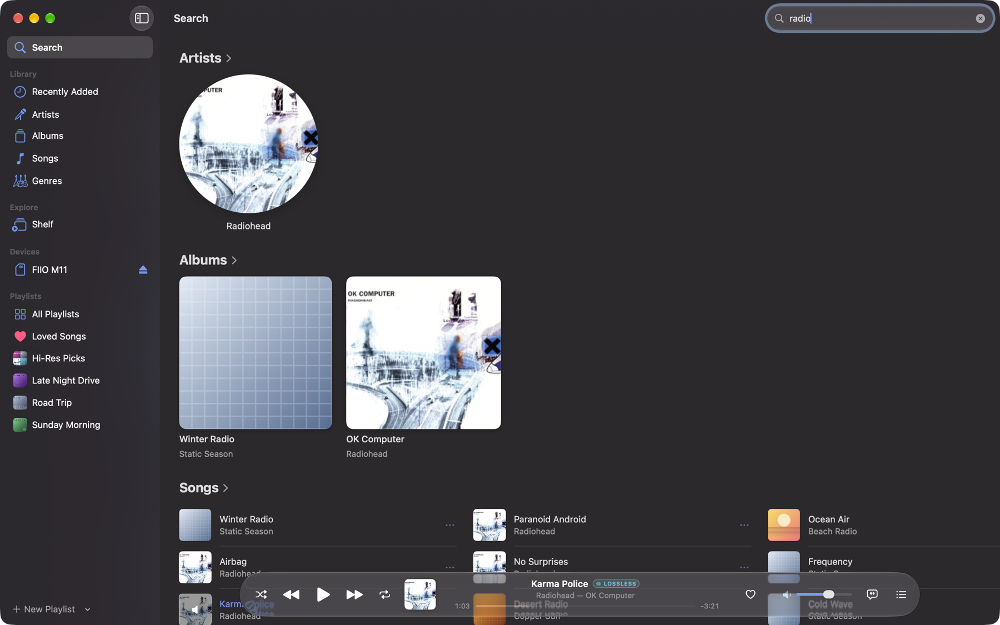 |
| **Songs** with format and resolution for every file: Hi-Res, Lossless or High Quality at a glance. | **Search** across artists, albums, songs and the people in the credits. |
| 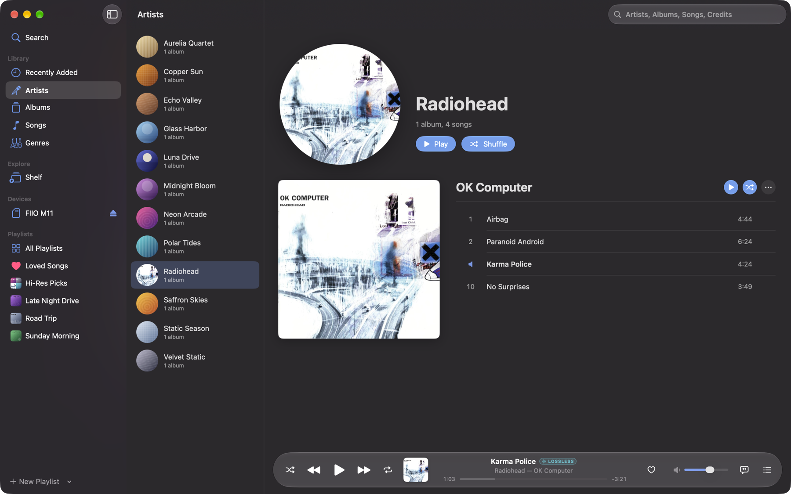 | 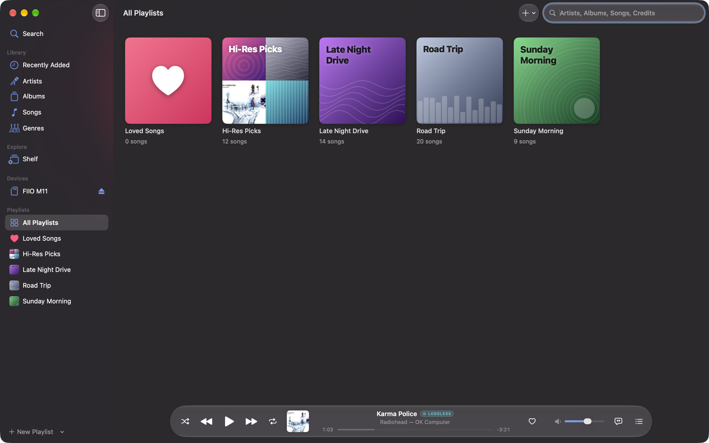 |
| **Artist pages** with every album and its songs, Music style. | **Playlists** with covers you design, and smart playlists that update themselves. |

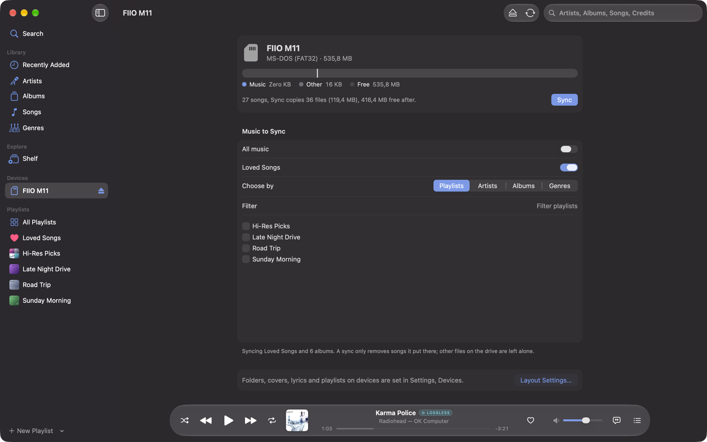

**Devices**: plug in a DAP or an SD card, choose what goes on it, see how much room it takes, and sync.

## Features

### Library
- Watches your music folders live (FSEvents), catches up with what changed while it was closed, and keeps songs on unplugged drives until they come back.
- Several library folders, on internal, external or network drives; security-scoped access, sandboxed app.
- Recently Added, Artists, Albums (cover size by slider, menu or pinch), Songs (sortable table with quality), Genres.
- Album artists and compilations, multi-disc albums, CUE sheets (external or embedded) shown as individual songs.
- Search with categories (artists, albums, songs, credited people), recent searches, and a toolbar field reachable everywhere (⌘F).
- Get Info with a tag editor for one song or many at once; ratings, loves with dates, play and skip counts.
- Import songs or folders (drag them onto the window, or ⌘O), identified on MusicBrainz and moved or copied into your layout.
- Organize files into a folder and name template you choose, previewed before anything moves, with undo.
- Backups of the whole library (history, playlists, metadata fixes, settings) and restore, including relinking moved folders.

### Playback
- Gapless playback, crossfade (1 to 12 s, keeping albums gapless if you like), playback speed with pitch kept, sleep timer (minutes or end of song).
- Bit-perfect output: the device follows each song's sample rate and the deepest integer format, exclusive access on request, device volume used instead of digital volume.
- Sound Check: ReplayGain (track or album) and EBU R128 measurement for songs without tags.
- Up Next queue with Play Next and Add to Up Next everywhere, shuffle, repeat one or all.
- Media keys and Control Center, a menu bar mini player, and a floating player bar with Liquid Glass.

### Sound
- 15-band parametric equalizer: peak, shelf, pass and notch filters per band, frequency 20 Hz to 20 kHz, gain ±24 dB, Q 0.1 to 18.
- Draggable curve over a log-frequency scale, sliders, an on/off switch to compare, automatic preamp.
- Built-in presets, your own presets, import and export of AutoEq / Equalizer APO `ParametricEQ.txt`.
- Audio quality details for every song: codec, bit depth, sample rate, bitrate, and what actually reaches the output device.

### Now Playing, lyrics and visualizers
- Full-screen Now Playing that scales to large displays, with an animated artwork backdrop.
- Synced (LRC) lyrics from your files or LRCLIB, karaoke-style line following, click to seek; plain lyrics too.
- Lyrics and Up Next side panels on every page.
- Cover Flow shelf with reflections, keyboard, trackpad and scrubber control, and the flip to the track list.
- Metal visualizers: Bars & Waves, Lights, Ambience and Magnetosphere, in a window or full screen.

### Metadata
- Fix Metadata: candidates from MusicBrainz, a field-by-field review, optional writing to the files.
- Artwork from your files, cover images in the folder, the Cover Art Archive and the iTunes Search API.
- Credits (performers, producers, engineers, songwriters, studios) with a page for every person and the songs they worked on.
- Album and artist backgrounds from Wikipedia, artist photos.
- Fetch Missing Info for the whole library in the background.

### Playlists
- Playlists with drag and drop and reordering; smart playlists with rules, limits and live updates; Loved Songs.
- Covers: generated colors and patterns with the playlist's name, your own image, or a mosaic of the songs' covers, also in the sidebar.
- Import M3U, M3U8, PLS, XSPF, WPL and Music / iTunes XML; export M3U8, M3U, PLS, XSPF and Music XML, with absolute or relative paths.

### Devices
- DAPs in USB disk mode, SD cards and USB drives appear under Devices while they are connected.
- Choose all music or a mix of playlists, artists, albums, genres and Loved Songs; see what a sync copies and removes, and the space left.
- One layout for every device: folders and names, cover.jpg size, .lrc lyrics, M3U8 playlists. Names safe for FAT32 and exFAT; files over 4 GB left out of FAT32 cards.
- Incremental: only new and changed files are copied; only Groovelight's own files are ever removed.
- Send to: any song, album or playlist to a device or a folder, from its menu.
- **Groovelight Sync for Android** (Android 12+): pairs with a code shown on both screens, then syncs over Wi-Fi to internal storage or the SD card, by itself every 15 minutes if you like. Downloads resume, and player apps see the songs at once.

### Last.fm
- Scrobbling with Last.fm's rules, Now Playing updates, love and unlove synced with the heart button.
- Scrobbles made offline are kept and sent later.

### Mac
- Liquid Glass throughout, light and dark (the Shelf is always dark), one library window like Music.
- Every action in the menus; keyboard shortcuts you can remap (Settings, Shortcuts).
- Updates from GitHub releases, verified before installing (Sparkle).

## Install

Download the latest DMG from [Releases](https://github.com/irwingbraga/groovelight/releases/latest), open it and drag Groovelight to Applications. Requires macOS 26 or later.

The Android companion app, Groovelight Sync, is attached to each release as an APK (Android 12 or later): see [`android/README.md`](android/README.md) for installing it.

## Keyboard shortcuts

The defaults are below. Every shortcut is also in the menus, and each one can be changed, removed or reset in Settings, Shortcuts (keys already used by another command or by macOS are refused). On non-US keyboards macOS may move some default keys (Back shows as ⌘Ç on a Portuguese layout); recorded shortcuts keep the exact keys pressed.

| Action | Shortcut |
|---|---|
| Play / Pause | Space (outside text fields), ⌥⌘P |
| Next / Previous | ⌘ Right Arrow / ⌘ Left Arrow |
| Skip forward / back 10 seconds | ⌥⌘ Right Arrow / ⌥⌘ Left Arrow |
| Volume up / down, Mute | ⌘↑ / ⌘↓, ⌥⌘↓ |
| Shuffle, cycle Repeat (off, all, one) | ⌘S, ⌘R |
| Love the current song, Go to Current Song | ⇧⌘L, ⌘L |
| Search Library | ⌘F |
| Recently Added, Artists, Albums, Songs, Genres, Shelf, All Playlists, Loved Songs | ⌘1 to ⌘8 |
| Back | ⌘[ |
| Now Playing (Esc closes it), Lyrics, Up Next | ⇧⌘F, ⌥⌘L, ⌥⌘U |
| Visualizer, Equalizer | ⌘T, ⌥⌘E |
| Bigger / Smaller covers (Albums page; also its toolbar slider and pinching) | ⌘+ / ⌘− |
| Library window (a single window; reopens it after closing) | ⌘0 |
| New Playlist, New Smart Playlist | ⌘N, ⌥⌘N |
| Import (songs or folders), Add Folder to Library | ⌘O, ⇧⌘O |
| Fetch Missing Info in Background, Back Up Library | ⇧⌘U, ⌥⌘B |
| Settings | ⌘, |

## Build from source

```sh
brew install xcodegen
git clone https://github.com/irwingbraga/groovelight.git && cd groovelight
xcodegen generate
open Groovelight.xcodeproj        # or: xcodebuild -scheme Groovelight -configuration Release build
(cd GroovelightKit && swift test) # the package's tests
```

Requirements: macOS 26+ and Xcode 26+. The code layout, the release pipeline, the demo library, performance tests and the debug tours are described in [docs/DEVELOPMENT.md](docs/DEVELOPMENT.md).

## Built with

[SFBAudioEngine](https://github.com/sbooth/SFBAudioEngine) for decoding and playback, [GRDB](https://github.com/groue/GRDB.swift) for the library, [Sparkle](https://sparkle-project.org) for updates, and the codec libraries listed in [THIRD_PARTY_NOTICES.md](THIRD_PARTY_NOTICES.md). Metadata from [MusicBrainz](https://musicbrainz.org), the [Cover Art Archive](https://coverartarchive.org), [Wikipedia](https://www.wikipedia.org), [LRCLIB](https://lrclib.net) and [Last.fm](https://www.last.fm).

The albums in the screenshots are a demo library generated by Groovelight's tests (made-up artists, synthesized music, generated covers), plus one real album to show credits and lyrics.

## License

Groovelight is free software under the [GNU General Public License v3.0](LICENSE). The software it includes keeps its own licenses: see [THIRD_PARTY_NOTICES.md](THIRD_PARTY_NOTICES.md).
