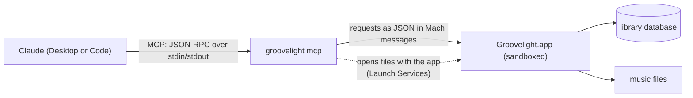

# Groovelight for Claude and AI tools (MCP)

Groovelight includes an MCP server (Model Context Protocol), so Claude and other AI tools can work with your music library: answer questions about it, play music, make playlists, and import, fix and organize files. Changes to files always come as a preview first, applied only after you agree.

The server is `groovelight mcp`, a mode of the [command line tool](CLI.md) inside the app. Like the tool, it never opens the library itself: it asks the running Groovelight to do the work.

- [Connect Claude Desktop](#connect-claude-desktop)
- [Connect Claude Code](#connect-claude-code)
- [Other MCP clients](#other-mcp-clients)
- [What you can ask](#what-you-can-ask)
- [Tools](#tools)
- [Safety: preview, then apply](#safety-preview-then-apply)
- [How it works](#how-it-works)
- [Protocol details](#protocol-details)
- [Development and testing](#development-and-testing)
- [Troubleshooting](#troubleshooting)
- [Privacy](#privacy)

## Connect Claude Desktop

1. Download `Groovelight-<version>.mcpb` from the [latest release](https://github.com/irwingbraga/groovelight/releases/latest) (Settings, General, Use with Claude links to it).
2. Open it: Claude Desktop shows Groovelight with its icon and tools; install it.
3. Ask Claude about your music. Claude Desktop may ask you to allow each tool the first time it is used.

The extension is a small launcher: it runs the `groovelight mcp` inside your installed Groovelight, so it always matches your version of the app and needs no update of its own. It looks for the app in `/Applications`, then `~/Applications`, then anywhere Spotlight knows, and only uses a copy it found that way if it is signed by Groovelight's developer (so a look-alike app cannot stand in). Its **Groovelight app** setting (in the extension's settings in Claude Desktop) points it at another copy, such as a development build.

Without the extension, add the server to `~/Library/Application Support/Claude/claude_desktop_config.json` yourself (after [installing the command line tool](CLI.md#install)), then quit and reopen Claude Desktop:

```json
{
  "mcpServers": {
    "groovelight": {
      "command": "/usr/local/bin/groovelight",
      "args": ["mcp"]
    }
  }
}
```

Claude Desktop shows a server added this way by its key (`groovelight` here).

## Connect Claude Code

[Install the command line tool](CLI.md#install), then:

```sh
claude mcp add groovelight -- /usr/local/bin/groovelight mcp
```

In Claude Code, `/mcp` shows whether it is connected. Claude Code can also use the [command line tool](CLI.md) directly through the shell; the MCP server gives it typed tools, the preview step and structured results.

## Other MCP clients

Any client that runs local stdio servers can use it: the command is `/usr/local/bin/groovelight` (or the path inside the app) with the argument `mcp`, no environment variables or keys needed. The app must be on the same Mac and the same user account.

## What you can ask

- "How big is my library? Which folder do imports go to?"
- "What Radiohead albums do I have?" / "Do I have Living Inside Myself by Gino Vannelli?"
- "Play Kid A" / "Play Karma Police by Radiohead" / "Shuffle my 90s rock playlist" / "Skip this song"
- "Create a playlist with the top 10 Gino Vannelli hits" (Claude searches your library for each song and tells you which ones you do not have)
- "Import ~/Downloads/album.zip and move the zip to the Trash afterwards"
- "Fix the metadata of OK Computer" / "The songs of Brother to Brother have different album names, fix them as one album"
- "Rename my files with my naming settings, only for the Steely Dan albums"
- "Undo that import"

## Tools

| Tool | What it does | Changes |
|---|---|---|
| `library_status` | Library size, music folders (and which one imports go to), what is playing. | Nothing |
| `search_library` | Artists, albums and songs matching a query (title, artist, album, lyrics, credits). Songs come with their ids and file paths. | Nothing |
| `now_playing` | The song playing or paused, with its position. | Nothing |
| `list_playlists` | Playlists with their song counts. | Nothing |
| `preview_import` | What importing songs, folders or archives would do: each album as identified on MusicBrainz and where each file would go. Returns a `preview_id`. | Nothing |
| `import_music` | Imports what a preview showed. Takes the `preview_id` only. | Files (undoable) |
| `preview_fix_metadata` | The best MusicBrainz release for an album (or the one asked for), the tag changes song by song, and the other releases found. Returns a `preview_id`. | Nothing |
| `apply_fix_metadata` | Applies the previewed changes, with the previewed release. Takes the `preview_id` only. | Tags (not undoable) |
| `preview_organize` | How files would be renamed with the naming settings (the library, an album or an artist). Returns a `preview_id`. | Nothing |
| `organize_files` | Renames as previewed. Takes the `preview_id` only. | Files (undoable) |
| `undo_last_file_operation` | Undoes the last import or organize. | Files |
| `rescan_library` | Checks every file of the library folders. | Library |
| `create_playlist` | A new playlist of songs (ids from `search_library`), in order. | Library |
| `add_to_playlist` | Adds songs at the end of a playlist. | Library |
| `play` | One song, songs by id, what a search finds, an album, an artist or a playlist; nothing resumes. | Playback |
| `playback_control` | `pause`, `resume`, `toggle`, `next`, `previous` or `stop`. | Playback |

### Arguments

| Tool | Arguments |
|---|---|
| `search_library` | `query` (required), `limit` (each kind, default 20) |
| `preview_import` | `paths` (required, absolute paths), `folder`, `copy`, `use_online_metadata` (default true), `write_tags` (default true), `trash_archives` (default false) |
| `preview_fix_metadata` | which songs: `album` (with `artist` to tell albums apart), `artist`, or `song_ids`; `search_album`, `search_artist` (search for these instead; empty leaves the field out), `release` (a MusicBrainz release id), `include_unmatched`, `cover` (default true), `write_tags` (default: the user's setting) |
| `preview_organize` | `album`, `artist` (none: the whole library) |
| `import_music`, `apply_fix_metadata`, `organize_files` | `preview_id` (required) |
| `create_playlist` | `name`, `song_ids` (both required) |
| `add_to_playlist` | `playlist` (its name), `song_ids` (both required) |
| `play` | `song`, `song_ids`, `query`, `album`, `artist`, `playlist`, `shuffle`. A song or query comes first, and `artist` and `album` narrow it down; alone, `album` plays the album and `artist` every song of the artist. |
| `playback_control` | `action` (required) |

Names match ignoring case and accents; a part is enough when only one thing matches, and several matches come back as an error listing them.

Every result has the summary as text (what Claude reads) and the data as `structuredContent` (the same JSON as the command line's [`--json`](CLI.md#output-json-and-exit-codes)). Failures come back as results with `isError`, so Claude can read the reason and react.

### Keeping Claude up to date

You keep using Groovelight while you talk to Claude: songs change, you skip, you edit playlists. An MCP server cannot make Claude look again after a while (Claude only acts when you send a message), so the server tells it how old each answer is and when to ask again:

- The results of `library_status`, `search_library`, `list_playlists` and `now_playing` carry the time they were read: an `as_of` field in `structuredContent` (ISO 8601, with the Mac's time zone) and a last line `As of <time>.` in the text.
- The server's instructions say that a result shows the state when the tool ran, and to call the tool again before answering about what is playing, playlists or the library.
- The descriptions of `now_playing` and `list_playlists` repeat it.

Results of tools that change things, and errors, carry no time.

## Safety: preview, then apply

Changes to files take two steps:

1. A **preview tool** (`preview_import`, `preview_fix_metadata`, `preview_organize`) runs the change as a dry run and returns what it would do with a `preview_id`. Nothing changes.
2. The matching **apply tool** (`import_music`, `apply_fix_metadata`, `organize_files`) takes **only** that `preview_id` and runs exactly what was previewed.

What holds it in place:

- Apply tools take no other arguments, so Claude cannot change what was previewed.
- A `preview_id` works once, only with its own apply tool, and only in the session that made it.
- A metadata fix applies the release that was previewed, even if MusicBrainz would rank another first later.
- The server's instructions and the tool descriptions tell Claude to show you the preview and wait for your agreement; tool annotations mark what is read-only and what changes things, so Claude Desktop can ask before running changes.
- Imports and organizing can be undone (`undo_last_file_operation`); archives moved to the Trash come back. Metadata fixes cannot, and their tool says so.
- Nothing that exists only once is deleted: archives go to the Trash, and undoing an import removes only copies (the originals, or the archive, still have the songs) or moves files to the Trash.

Playlists and playback skip the preview: they do not touch files, and playlists can be deleted in the app.

### What an AI tool cannot do

Text the model reads can carry instructions: a web page, a document, even a song's tags or lyrics returned by `search_library`. The server is built so that following such an instruction does limited harm:

- **It cannot read your files.** No tool returns the contents of a file; results are library data (titles, artists, albums, paths, play counts). There is no tool for lyrics, credits, settings, Last.fm or anything in the keychain.
- **It cannot widen what the app can read.** `preview_import` refuses broad and private places: `/`, your home folder as a whole, `~/Library` (except iCloud Drive and cloud storage folders), hidden folders such as `~/.ssh`, and system folders. The same rules are checked again in the app. See [import in CLI.md](CLI.md#import).
- **It cannot get files out of archives that point elsewhere.** Symbolic links in an archive are removed after extracting it.
- **It cannot change files without a preview,** and every file change except a metadata fix can be undone. Archives go to the Trash, never deleted.
- **It reaches nothing but Groovelight.** The server talks only to the app over a local Mach port; it opens no network connections. The app contacts MusicBrainz and the other metadata services only as it does from its windows, with album and artist names to look up.

Two habits keep the remaining risk low: read the preview before saying yes, and in Claude Desktop do not choose "Always allow" for `import_music`, `apply_fix_metadata`, `organize_files` and `undo_last_file_operation`, so each change asks you first.

The port itself is reachable only by programs running as you on this Mac (Mach ports are not visible to other users or over the network), and sandboxed apps from other developers cannot look it up. A program running as you can already read your music and the library, so the port gives it nothing new beyond controlling the player.

## How it works



1. **Claude to the tool.** Claude starts `groovelight mcp` and talks MCP to it over stdin and stdout.
2. **The tool to the app.** Each tool call becomes a request to the running app on a Mach message port named after the app's App Group (the only kind of name a sandboxed app may publish). If the app is not running, the tool starts it in the background.
3. **The app does the work** with the same code as its windows (Import, Fix Metadata, Organize Library Files, playlists, the player), so there is one writer, undo works, and the windows update live.
4. **Long work** (imports, fixes, organizing, rescans) runs as a job: the tool polls it for progress, passed to Claude as MCP progress notifications, and its result.
5. **File access.** The sandboxed app may not read a path it is sent. Before an import, the tool tells the app which paths are coming and opens them with Groovelight through Launch Services, as Finder's Open With does; that gives the app access to exactly those files.

More detail for developers (the message port, jobs, file access) in [DEVELOPMENT.md](DEVELOPMENT.md#command-line-tool).

## Protocol details

| | |
|---|---|
| Transport | stdio: newline-delimited JSON-RPC 2.0 on stdin and stdout; logs on stderr |
| Protocol versions | 2025-11-25, 2025-06-18, 2025-03-26, 2024-11-05 (the client's when supported) |
| Methods | `initialize`, `ping`, `tools/list`, `tools/call`; notifications get no reply |
| Server info | name `groovelight`, title Groovelight, version of the app |
| Capabilities | `tools` (the list does not change) |
| Progress | `notifications/progress` when a call carries `_meta.progressToken`, sent when the step or count changes |
| Results | `content` (text), `structuredContent` (object), `isError`; read-only state results add `as_of` (see [Keeping Claude up to date](#keeping-claude-up-to-date)) |
| Instructions | The server sends instructions telling the model to preview before changing files, how to make playlists (search for ids, then create), that paths are absolute, and that results go stale as the user uses the app |

The implementation is `GroovelightKit/Sources/ControlKit/MCPServer.swift` (no dependencies; tested without the app in `MCPServerTests`). The tools map to the app's requests (`ControlRequest`), the same ones the command line uses.

### The Claude Desktop extension

`Groovelight-<version>.mcpb` is a zip with:

- `manifest.json` (from [`extension/manifest.json`](../extension/manifest.json), `manifest_version` 0.3): a `binary` server whose command is `/bin/sh` running the launcher, with the **Groovelight app** setting as its argument.
- `server/groovelight-mcp`: the launcher script. It takes the app in the setting as it is (or fails when that copy has no tool); otherwise it looks in `/Applications`, `~/Applications` and Spotlight, accepting only a copy whose signature passes `codesign --verify --strict` with the developer's Team ID as requirement. It then runs the app's own `groovelight mcp`; without the app it explains how to get it.
- `icon.png`: the app icon, 512 by 512.

`scripts/make-mcpb.sh path/to/Groovelight.app [output folder]` stamps the app's version, makes the icon from `Groovelight.icns`, validates the manifest and packs the extension with [`@anthropic-ai/mcpb`](https://github.com/modelcontextprotocol/mcpb). The release workflow attaches it to each release. `MCPServerTests` checks that the manifest lists the server's tools.

## Development and testing

**A build from Xcode.** Run the app (⌘R), then point a client at the tool inside the build. Debug builds use their own message port, so they never mix with an installed Groovelight.

```sh
APP=~/Library/Developer/Xcode/DerivedData/Groovelight-<id>/Build/Products/Debug/Groovelight.app
"$APP/Contents/Helpers/groovelight" status
claude mcp add groovelight-dev -- "$APP/Contents/Helpers/groovelight" mcp
```

In Claude Desktop, either set the extension's **Groovelight app** to `$APP`, or add a `groovelight-dev` entry with the full path to `claude_desktop_config.json`. A build from Xcode works on your real library (same bundle id and container); a throwaway library needs the unsandboxed build described in [DEVELOPMENT.md](DEVELOPMENT.md#command-line-tool).

**MCP Inspector** lists the tools and calls them by hand:

```sh
npx @modelcontextprotocol/inspector "$APP/Contents/Helpers/groovelight" mcp
```

**By hand**, one JSON-RPC message per line:

```sh
printf '%s\n' \
  '{"jsonrpc":"2.0","id":1,"method":"initialize","params":{"protocolVersion":"2025-06-18","capabilities":{},"clientInfo":{"name":"test","version":"1"}}}' \
  '{"jsonrpc":"2.0","method":"notifications/initialized"}' \
  '{"jsonrpc":"2.0","id":2,"method":"tools/call","params":{"name":"library_status","arguments":{}}}' \
  | "$APP/Contents/Helpers/groovelight" mcp
```

**Tests:** `(cd GroovelightKit && swift test --filter "MCPServerTests|ControlKitTests")`.

**Changing tools:** add the request to `ControlRequest` (ControlKit), answer it in `ControlService` (app), add the tool to `MCPServer.tools` and its call, and list it in `extension/manifest.json` (a test fails otherwise). Keep changes to files behind a preview tool.

## Troubleshooting

| Symptom | What to do |
|---|---|
| The extension says Groovelight is not installed | Install Groovelight 0.4 or later in Applications (older versions have no command line tool), or set the extension's **Groovelight app**. |
| Tools fail with "did not answer in time … showing a dialog" | Groovelight is waiting on a dialog, often a keychain or permission prompt: answer it in the app. |
| "busy with another command" | One import, fix, organize or rescan runs at a time. |
| A different song or album plays | Ask with the title and the artist (and the album, for one of several versions). For a song Groovelight plays the first match, the exact title first; for albums, artists and playlists it lists the matches instead of guessing. |
| The server shows as failed in Claude Desktop | Settings, Developer shows its log; `~/Library/Logs/Claude/mcp-server-<name>.log` keeps it. Check the path in the config, and that Groovelight opens. |
| Claude says it cannot do something | It only has the tools above: tell it which one, or use the app. |

## Privacy

The MCP server runs on your Mac and talks only to Groovelight. What the tools return (song titles, artists, file paths, playlists) goes to the AI tool you connected, and from there to its model provider under that tool's terms. File paths include your user name (`/Users/<you>/...`). Groovelight itself sends nothing to Claude, writes no log of requests, and keeps no copy of what the tools returned; it contacts MusicBrainz, the Cover Art Archive and the other metadata services for imports and fixes, as it does from its windows.
